# Call Registration Flow - Detailed Flowchart

## Overview

This flowchart illustrates the complete call registration process with all 4 steps, validations, and API interactions.

```mermaid
flowchart TD


    %% Step 1: Customer Details
    Step1 --> FillCustomer[Fill Customer Information:<br/>- Call By Customer/Dealer<br/>- Title Mr/Mrs/Ms/Dr<br/>- First Name<br/>- Last Name<br/>- Phone 10 digits<br/>- Alternate Phone 10 digits]

    FillCustomer --> ValidateStep1{Validate<br/>All Fields?}
    ValidateStep1 -->|Missing Fields| ShowError1[Show Error Messages]
    ShowError1 --> FillCustomer
    ValidateStep1 -->|Valid| Step2[Step 2: Address Details]

    %% Step 2: Address Details
    Step2 --> FillAddress[Fill Address Information:<br/>- Customer Address<br/>- Landmark<br/>- Enter Pincode 6 digits]

    FillAddress --> PincodeEntered{Pincode<br/>6 Digits?}
    PincodeEntered -->|No| FillAddress
    PincodeEntered -->|Yes| SetChecking[Set Status: Checking]

    SetChecking --> APICallPincode[API: GET /LocalityMaster/by-pincode/pincode]


    APICallPincode --> PincodeValid{Valid<br/>Pincode?}
    PincodeValid -->|No| ShowInvalid[Show: Invalid Pincode<br/>Reset State/City/Locality]
    ShowInvalid --> FillAddress

    PincodeValid -->|Yes| AutoFill[Auto-fill:<br/>- State read-only<br/>- City read-only<br/>- Locality dropdown<br/>- Locality ID<br/>- City ID]

    AutoFill --> SelectLocality[User Selects Locality<br/>from Dropdown]
    SelectLocality --> ValidateStep2{Validate<br/>Address Fields?}
    ValidateStep2 -->|Invalid/Checking| ShowError2[Show Error Messages]
    ShowError2 --> FillAddress
    ValidateStep2 -->|Valid| Step3[Step 3: Product Details]

    %% Step 3: Product Details
    Step3 --> LoadDropdowns[Load Dropdowns:<br/>- Brands API: GET /BrandMaster<br/>- Products API: GET /productmaster/GetAll<br/>- Warranties API: GET /warrantymaster]

    LoadDropdowns --> EnterSerial[Enter Serial Number]
    EnterSerial --> SerialBlur{Serial Number<br/>Entered?}
    SerialBlur -->|Yes| CheckSerial[API: GET /SerialNoMaster/by-serial/serial]

    CheckSerial --> SerialExists{Serial<br/>Exists?}
    SerialExists -->|No| ShowSerialError[Show: Invalid Serial Number<br/>Allow Manual Selection]
    ShowSerialError --> ManualSelect

    SerialExists -->|Yes| AutoFillProduct[Auto-fill & Lock:<br/>- Brand<br/>- Product Category<br/>- Product<br/>- Model<br/>- Model Description<br/>- Warranty<br/>Show: Valid Serial]

    AutoFillProduct --> FetchModels[API: GET /Model/productid/productID]
    FetchModels --> FillDOP[Enter DOP Date of Purchase]
    FillDOP --> ValidateStep3{Validate<br/>Product Fields?}

    SerialBlur -->|No| ManualSelect[Manual Selection:<br/>1. Select Brand<br/>2. Select Product Category<br/>3. Select Product<br/>4. Fetch Models for Product<br/>5. Select Model Active Only<br/>6. Enter Model Description<br/>7. Enter DOP<br/>8. Select Warranty]

    ManualSelect --> ValidateStep3
    ValidateStep3 -->|Missing Fields| ShowError3[Show Error Messages]
    ShowError3 --> EnterSerial
    ValidateStep3 -->|Valid| Step4[Step 4: Service Details]

    %% Step 4: Service Details
    Step4 --> FillService[Fill Service Information:<br/>- Call Type<br/>- Fault Description VOC<br/>- Available Time <br/>-remarks<br/>caller number]

    FillService --> ValidateStep4{Validate<br/>Service Fields?}
    ValidateStep4 -->|Missing Fields| ShowError4[Show Error Messages]
    ShowError4 --> FillService
    ValidateStep4 -->|Valid| SubmitCall[Submit Call Registration]

    %% Submission Flow
    SubmitCall --> PreparePayload[Prepare Payload with:<br/>- All Customer Details<br/>- Address with IDs<br/>- Product with IDs<br/>- Service Details<br/>- User Info]

    PreparePayload --> APISubmit[API: POST /callregister/create-complaint]

    APISubmit --> SubmitSuccess{Submission<br/>Successful?}
    SubmitSuccess -->|No| ShowSubmitError[Show Error Message]
    ShowSubmitError --> FillService

    SubmitSuccess -->|Yes| GetTicketNo[Get Ticket Number<br/>from Response]

    GetTicketNo --> CheckCallType{Call Type =<br/>Installation/Demo/Service?}
    CheckCallType -->|No| ShowSuccess
    CheckCallType -->|Yes| SendSMS[API: POST /SMS/send<br/>Send Welcome SMS<br/>with Ticket Number]

    SendSMS --> ShowSuccess[Show Success Screen:<br/>Display Ticket Number<br/>Show Register Another Button]

    ShowSuccess --> UserChoice{User Action?}
    UserChoice -->|Register Another| ResetForm[Reset Form Data<br/>Clear Ticket Number]

    UserChoice -->|Done| End([End])



    style End fill:#ffe1e1

    style ValidateStep1 fill:#fff4e1
    style ValidateStep2 fill:#fff4e1
    style ValidateStep3 fill:#fff4e1
    style ValidateStep4 fill:#fff4e1
    style PincodeValid fill:#fff4e1
    style SerialExists fill:#fff4e1
    style SubmitSuccess fill:#fff4e1
    style CheckCallType fill:#fff4e1
    style Step1 fill:#e1f0ff
    style Step2 fill:#e1f0ff
    style Step3 fill:#e1f0ff
    style Step4 fill:#e1f0ff
    style APICallPincode fill:#f0e1ff
    style CheckSerial fill:#f0e1ff
    style FetchModels fill:#f0e1ff
    style APISubmit fill:#f0e1ff
    style SendSMS fill:#f0e1ff
```

## Key Features

### Validation Rules

- **Step 1**: All 6 fields required (Call By, Title, First Name, Last Name, Phone, Alt Phone)
- **Step 2**: Address, Landmark, and valid 6-digit pincode required
- **Step 3**: Serial No, Product Category, Brand, DOP, Product, Model, Model Description, Warranty required
- **Step 4**: Call Type, Fault Description, Available Time required

### API Integrations

1. **Pincode Validation**: `/LocalityMaster/by-pincode/{pincode}`
2. **Serial Number Check**: `/SerialNoMaster/by-serial/{serial}`
3. **Dropdowns**: `/BrandMaster`, `/productmaster/GetAll`, `/warrantymaster`
4. **Models**: `/Model/productid/{productID}`
5. **Submit**: `/callregister/create-complaint`
6. **SMS**: `/SMS/send`

### Special Behaviors

- **Pincode**: 400ms debounce before API call
- **Serial Number**: Auto-fills and locks fields if valid
- **Models**: Only shows ACTIVE status models
- **SMS**: Only sent for Installation/Demo/Service call types
- **Navigation**: Back button available from Step 2-4
